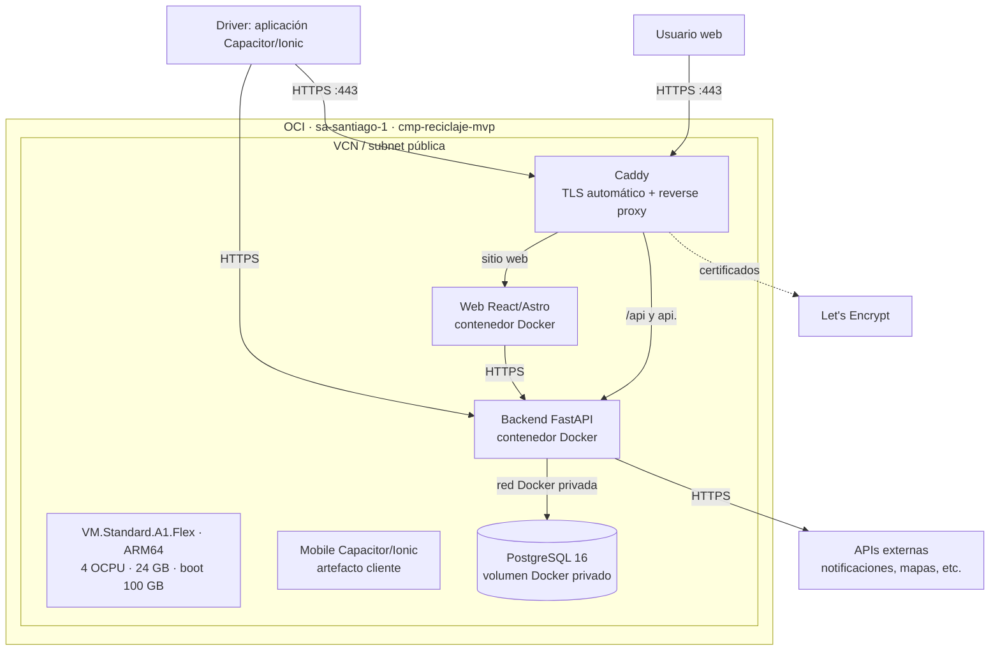

# Diseño de infraestructura de producción

## Objetivo y alcance

Este documento define la arquitectura objetivo de producción para Recycling Logistics
en Oracle Cloud Infrastructure (OCI), dentro de las cuotas Always Free. La
infraestructura se administra con Terraform y ejecuta imágenes inmutables publicadas
en GHCR. No incluye un despliegue automático: publicar una imagen y desplegarla son
operaciones manuales, separadas y auditables.

El módulo ejecutable vigente está en
[`environments/production/`](../../environments/production/). La carpeta
[`terraform/`](../../terraform/) es un esqueleto de diseño para descomponer ese
módulo en el siguiente paso; no debe aplicarse ni debe mantener un state independiente.

## Stack y componentes

| Componente | Tecnología | Responsabilidad |
|---|---|---|
| API | FastAPI | API de negocio, autenticación, validación y acceso a datos. |
| Base de datos | PostgreSQL 16 | Persistencia transaccional. No se expone a Internet. |
| Portal web | React/Astro | Interfaz administrativa servida como contenido estático. |
| Aplicación móvil | Capacitor/Ionic | Aplicación de conductor; consume la API mediante HTTPS. |
| Reverse proxy | Caddy | Terminación TLS, certificados Let's Encrypt, enrutamiento por host y contenido web estático. |
| Runtime | Docker Compose | Ejecuta las imágenes ARM64 de los componentes en la instancia OCI. |

Las imágenes se construyen en los repositorios de aplicación y se publican en GHCR.
`recycling-infra` solo aprovisiona OCI y despliega tags de imagen ya publicados.

## Infraestructura OCI

| Recurso | Diseño |
|---|---|
| Región | `sa-santiago-1`. |
| Compartimento | `cmp-reciclaje-mvp`, aislado de otros proyectos de la tenancy. |
| Cómputo | Una instancia Ampere ARM64 `VM.Standard.A1.Flex`. |
| Shape config | 4 OCPUs y 24 GB RAM, dentro de la cuota Always Free de A1. |
| Imagen base | Ubuntu LTS ARM64, con Docker Engine y Docker Compose instalados por cloud-init. |
| Boot volume | 100 GB. Mantiene margen para sistema, imágenes, logs y datos locales. Controlar consumo frente a la cuota Always Free de Block Volume. |
| Red | VCN dedicada, subnet pública, Internet Gateway y route table pública. |
| Ingress | TCP 80 y 443 públicos para Caddy; TCP 22 solo desde `ADMIN_CIDRS`. |
| Egress | Salida a Internet para actualizaciones, GHCR, Let's Encrypt y proveedores de API. |
| Estado Terraform | Bucket privado de OCI Object Storage creado durante bootstrap, usando interfaz S3-compatible desde GitHub Actions. |

Una única VM es adecuada para MVP Always Free, pero no ofrece alta disponibilidad ni
aislamiento fuerte entre test y producción. PostgreSQL y los servicios de aplicación
comparten fallo de infraestructura. Backups, observabilidad y separación de entornos
son pasos posteriores obligatorios antes de una carga crítica.

## Flujo de tráfico

Solo Caddy debe tener puertos publicados en la VM. PostgreSQL queda exclusivamente en
la red interna de Docker. La aplicación móvil no se despliega como servicio de la VM:
se distribuye al conductor y consume el endpoint público de la API.

## Mapeo GCP vs. OCI

| Concepto GCP | Equivalente OCI | Aplicación en este proyecto |
|---|---|---|
| Project | Compartment | `cmp-reciclaje-mvp` agrupa y aísla los recursos del MVP. |
| Organization | Tenancy | Cuenta raíz de OCI que contiene compartments, IAM y límites de cuota. |
| Folder | Jerarquía de compartments | Puede usarse para separar entornos o dominios cuando el proyecto crezca. |
| IAM principal/service account | User / Dynamic Group + policy | Usuario OCI con API key para Terraform; migrar a identidad de workload cuando exista una alternativa operativa adecuada. |
| VPC | VCN | Red virtual dedicada de la plataforma. |

Un GCP Project es una unidad de facturación, IAM y recursos. Un OCI Compartment cumple
la función de aislamiento y organización de recursos dentro de una Tenancy; por eso el
compartment se diseña por entorno o producto, no como una cuenta OCI independiente.

## Operación y controles

- Terraform `plan` y `apply` se ejecutan manualmente desde GitHub Actions; `apply`
  solo desde `main`, con confirmación explícita y aprobación del Environment
  `production`.
- El ciclo se separa en tres capas: Terraform crea recursos OCI y state; cloud-init
  prepara el host (Docker, Compose, UFW y acceso del usuario `ubuntu` al grupo
  `docker`); un script de despliegue actualiza imágenes ya publicadas.
- `main` requiere PR y revisión humana. No se permite modificar protección de rama para
  realizar un merge.
- SSH usa una clave dedicada. La llave privada vive solo en GitHub Environment secrets;
  `admin_cidrs` nunca debe usar `0.0.0.0/0`.
- El primer despliegue de test se realiza desde una estación administrativa mediante
  [`scripts/deploy-test-api.sh`](../../scripts/deploy-test-api.sh). Esto conserva SSH
  restringido a `ADMIN_CIDRS`, transmite el token GHCR solo por stdin y valida
  `/health` públicamente. El script no usa Terraform `remote-exec` ni escribe secretos
  en state.
- GitHub-hosted runners no acceden por SSH a la VM: sus rangos de IP son dinámicos y
  no justifican abrir el puerto 22. La automatización posterior reutilizará el mismo
  script desde un runner self-hosted aislado. OCI Run Command queda suspendido mientras
  el agente no pueda ejecutar comandos de forma confiable.
- Los valores concretos y el procedimiento de bootstrap están en
  [`oracle_admin_setup.md`](oracle_admin_setup.md).
